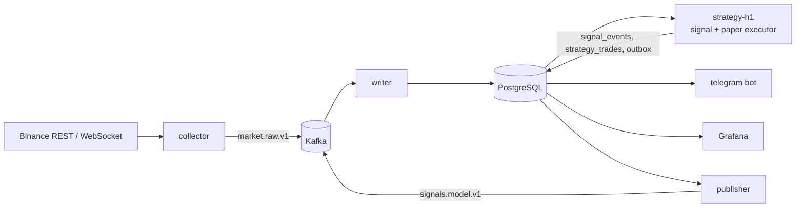

# BTC H1 Strategy Pipeline

A real-time research system for **BTCUSDT perpetual futures** (Binance USD-M). Every hour it runs a two-model strategy:
- a **touch** model predicts whether price will move ±b within 8 hours;
- a **direction** model (B) uses positioning data (open interest, long/short ratios, premium index) to choose the side.

Signals are tracked as **paper trades** by an executor that reproduces the backtest exactly. Results go to Telegram and Grafana.

> Research project and live **forward test**: the system never places real orders. Backtest numbers are out-of-sample per year. The trading configuration was selected while 2026 was visible (see *Validation*), so the live paper record is the clean test.

---

## Strategy (`model_training/strategy_h1.py`)

| Step | Rule |
|---|---|
| Barrier | b = clip(σ₁ₕ·√8, 1%, 5%) |
| Touch model | XGBoost (modelv2 features on 1h bars) predicts P(price touches +b or −b within 8 h). The touch filter passes when p_touch is in the top 20% (threshold taken from the calibration set). |
| Direction model B | XGBoost trained only on samples that actually touched, using 94 price features + 19 directional + 18 positioning features. Label: +b touched first. The direction filter passes when \|p_up − 0.5\| is in the top 10% among touch-filtered hours of the calibration set. |
| Entry | Open of the next 1h bar, in the direction of B. |
| Exit | TP = 1b and SL = 0.75b, each trade with its own levels. A bar that hits both counts as SL. **Fast exit:** a 5m candle against the trade with (high − low)/open ≥ 0.75% closes it at that candle's close. Maximum hold is 30 days. |
| Portfolio | At most 5 concurrent trades, at least 1 h apart. Risk is 1% of equity per trade, compounded. Fees are 0.1% round trip, charged as fee/SL in R. |

### Validation
- **Walk-forward by calendar year.**
  - Train: labels ending before 1 Jan of Y−1.
  - Year Y−1: the first 60% is used for early stopping; the last 40% calibrates the thresholds.
  - Test: year Y.
  - Samples straddling a boundary are purged.
- **Leakage checks:**
  - Label-permutation nulls: i.i.d. shuffles, and whole-day swaps that keep hour-of-day.
  - Logistic and single-feature baselines.
  - Feature-group ablation.
  - Positioning features lagged by an extra hour still carry signal.
  - Results are in `model_training/evaluate_strategy_h1.ipynb` and `artifacts/1h_eval/`.
- **Execution on 5m candles, 2023 → 2026-10-08:**
  - 796 trades, win rate 54.9%, **+0.188 R/trade** after fees.
  - R by year 53.5 / 42.3 / 23.7 / 29.9.
  - Max drawdown 20%, 2 negative quarters out of 15.
- **Direction edge:** it comes almost entirely from positioning data (account long/short z-score, open interest). Hit rate rises to 64–65% only in the most confident ~20% of hours.
- **Caveat:** the thresholds, SL multiple and fast-exit level were chosen after seeing 2023–2026. A clean re-selection on 2023–2025 only still gives every configuration in the stable region positive in 2026, but rankings of configurations are unstable across years. Treat the backtest as optimistic; the paper record decides.

## Architecture



| Service | Role |
|---|---|
| `collector` | REST backfill/recovery (28 days) + WebSocket candles. On 5m it collects candles, open interest, global account ratio, top-trader position ratio, top-trader **account** ratio, taker ratio and the **premium index**; funding is also collected. |
| `writer` | Validates and stores immutable events (`raw_events` → `observations`); idempotent. |
| `strategy-h1` | At each hour close: waits for the last 5m positioning row, then rebuilds features exactly as in training (see below) and writes `signal_events`. It also manages paper trades in `strategy_trades`: entry fill, TP/SL on 1m candles, fast exit on 5m candles, timeout, and compounding equity in `strategy_state`. |
| `telegram` | Trade opened / closed / skipped messages, daily summary, health alerts, `/status`, `/last`. |
| `public-site` | Public track-record page (results in % of account, every trade incl. losses, hourly signal log with a SHA-256 hash chain). Writes `artifacts/public/` and, if configured, pushes it to a GitHub repo served by GitHub Pages / Vercel / Cloudflare Pages; the commit history is a public timestamp record. |
| `grafana` | Pipeline health, hourly probabilities, open trades, closed trades, paper equity, cumulative R. |

### Live = backtest (verified)
- **Features:**
  - 1h candles are aggregated from 5m candles with the same function used in training (`strategy_h1.aggregate_1h`), over 200 days of history (≥ 180 days gives identical features).
  - The positioning table is rebuilt from REST rows with the same function that rebuilds the training table from data.binance.vision (`positioning_data.align`). That rebuild matches the training table exactly on every model column.
  - Live probabilities match walk-forward probabilities to within 1e-6. This is checked with the pinned Docker library versions in `historical_tests/test_strategy_live.py`.
- **Time convention of positioning data** (verified against klines): from 2024-03-04 a metric row stamped T describes [T, T+5m) and is known at T+5m. REST timestamps are assumed to equal data.binance.vision `create_time` (`POSITIONING_TS_SHIFT_MS=0`). Verify this with `python -m pipeline check-positioning`.
- **Executor:** `pipeline/strategy_exec.py`, replayed over all walk-forward signals on 5m candles, reproduces `backtest_m5` trade by trade (796/796 trades, |ΔR| < 1e-15).
  - Live default `STRATEGY_ENTRY=next_1m` fills at the open of the first 1m candle after the decision, which is more realistic.
  - The difference from the backtest fill price is stored per trade as `slippage_r`.

## Quick start

```bash
# 1. History + model (on the host)
python collect_historical.py --timeframes 5m 1h
python collect_positioning.py                    # data.binance.vision metrics + premium -> BTCUSDT_positioning_5m.csv
jupyter lab model_training/train_strategy_h1.ipynb   # writes artifacts/1h_strategy_v1/models_final.joblib

# 2. Configuration
cp .env.example .env                             # set POSTGRES_PASSWORD, TELEGRAM_BOT_TOKEN
docker compose run --rm telegram python -m pipeline telegram-setup   # prints your TELEGRAM_CHAT_ID

# 3. Run
docker compose up -d --build
docker compose run --rm cli                      # pipeline status (incl. paper trades and equity)
docker compose run --rm cli python -m pipeline check-positioning   # after ~2 days of collection
```

Grafana: http://localhost:3000 · Kafka UI: http://localhost:8080

The model bundle is stored in a portable format: XGBoost JSON with the config as a dict. It loads with any XGBoost 3.x and scikit-learn version, so the container does not need the training environment's exact library versions.

## Tests

```bash
python -m unittest historical_tests.test_strategy_live historical_tests.test_telegram \
    historical_tests.test_new_sources historical_tests.test_validation historical_tests.test_timeframes
# The live-pipeline test needs TEST_DATABASE_URL (an empty PostgreSQL database) + historical_data:
# it writes 28 days of REST-shaped events through the real validation/storage path, runs the worker hour by hour,
# and checks probabilities against walk-forward and every paper trade against an independent replay.
```

## Project structure

```
pipeline/              collector, writer, publisher, strategy_live (H1 worker), strategy_exec (paper executor), telegram bot
model_training/        strategy_h1.py + train_strategy_h1.ipynb   - touch + direction-B strategy (production)
                       evaluate_h1.py + evaluate_strategy_h1.ipynb - overfit / null / ablation / tuning / trade-grid evaluation
                       positioning_data.py                         - positioning table (training and live)
                       modelv2.py                                  - touch features, labels, walk-forward utilities
collect_historical.py  klines + funding from Binance REST
collect_positioning.py open interest / long-short ratios / premium index from data.binance.vision
historical_tests/      unit and integration tests
sql/schema.sql         database schema
monitoring/            Grafana provisioning and dashboard
```

## Disclaimer

Research and education only. The system does not place orders, and nothing here is investment advice.
